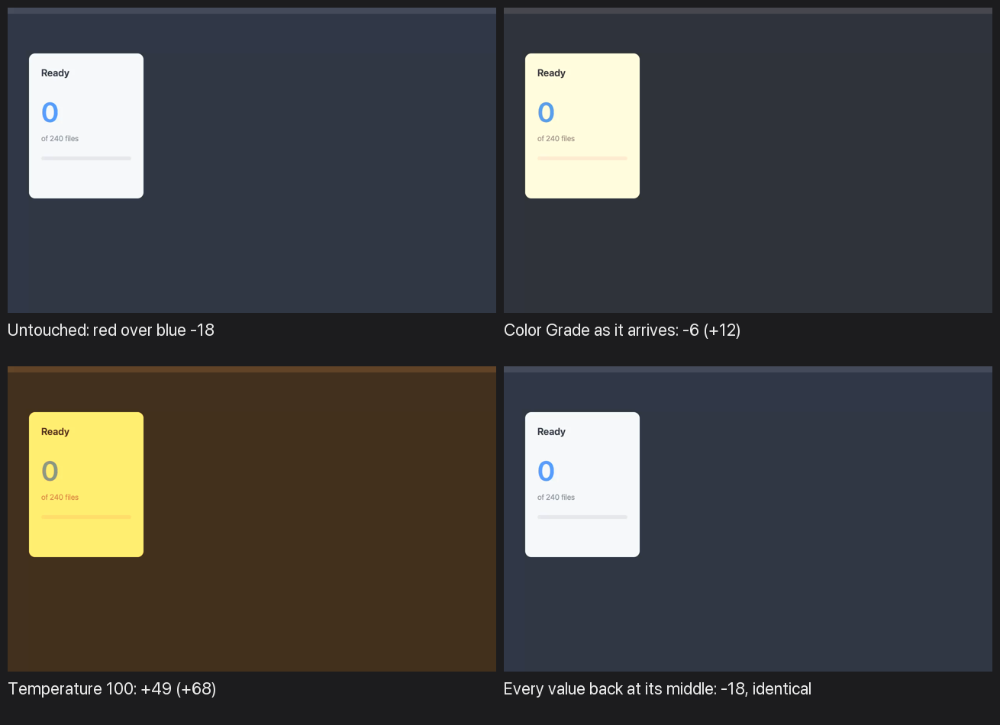

# Is this the Color Grade you want on a clip?

## What it is

A clip (or any picture) can now be colour graded. Pick the clip, press the **+**
on the **Effects** header (or Layer > Add Effect) and choose **Color Grade**. A
row called Color Grade appears at the top of the clip's Effects list, reading
"adjust" at its end the way the video mock's *Warm grade* row does
([video mock, Effects](http://127.0.0.1:8791/index.html#video)).

Under it are the five controls Premiere's Lumetri Color puts first:

| Row | Range | Middle |
| --- | --- | --- |
| Temperature | -100 (blue) to 100 (orange) | 0 |
| Tint | -100 (green) to 100 (magenta) | 0 |
| Exposure | -4 to 4 stops | 0.0 |
| Contrast | -100 (flat) to 100 (punchy) | 0 |
| Saturation | 0% (grey) to 300% | 100% |

Each is a slider with a number box, and on a video each has a key diamond in
front of its name, so a grade can warm over a shot the way a title fades in.
Saturation is also offered on every picture in **Animate a property**, as the
mock's catalogue lists it.

## What it looks like

Reel: [untouched, arriving, warm end](../audits/2026-10-17-color-grade-reel.gif)

Measured on the sample recording (mean red over blue across the frame):

- untouched: -18 (the recording is a cool slate blue)
- as it arrives: -6
- Temperature at 100: +49
- every value back at its middle: -18, and identical pixel for pixel

## The options

- **a. Keep it.** It arrives as a gentle warm look (Temperature 20, Contrast 10,
  Saturation 110), so the press visibly does something. The row is fixed at the
  top of Effects with no grip, like Blur: a grade always applies to the clip's
  own picture, whatever its place, so a grip would change nothing. (The mock
  draws a grip on its Warm grade row.)
- **b. Arrive at the middles.** Premiere's way: nothing changes until you move a
  slider.
- **c. Make the ends gentler.** At 100, Temperature turns a white card yellow and
  blue type grey. This halves that.
- **d. No colour grade.** Takes it back out of the Effects menu.

The other mock idea, a grade as its own layer with a blend mode and a matte
(`video-compositing.html`), and a saved "look" in the Library, are not part of
this.
