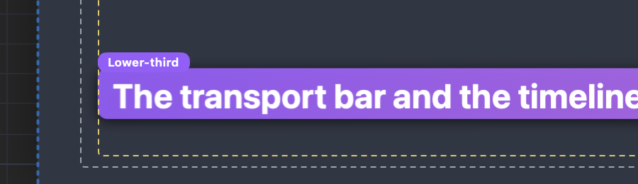

# Which icon should the Lower-third tag wear?

## What this is

When you caption a video and pick the **Lower third** caption style, the
captions move to the lower left of the picture on a violet plate. The captions
mock ([video captions](http://127.0.0.1:8791/index.html#video-captions)) also
puts a small violet tag reading **Lower-third** on the top left corner of that
plate, so you can tell the style at a glance. The tag is only on the canvas
while you edit. It never goes into the film you export.

The app now draws that tag in the mock's spot, size, colour and words. The one
thing held back is the little icon in front of the word.

## Why the icon is a question

The mock's icon is the **four diamonds**, the component icon. In the app, a
violet chip with four diamonds already means something specific: the canvas
puts exactly that chip on every **component**, a reusable piece you edit once
and change everywhere. Captions are not a component. A tag that looks like a
component chip tells you they are.

## The choices

- **a. Diamond icon, as the mock.** Matches the mock exactly, and looks like a
  component chip.
- **b. Label only (what you see today).** The word Lower-third on the violet
  chip, no icon.
- **c. Captions icon instead.** The small speech-bubble icon the Words track
  already wears, then the word. Keeps the mock icon-and-label shape and the
  icon tells the truth.
- **d. Take the tag away.** The violet plate on its own says it is a lower
  third.

The recommendation is **b**: it says what the style is and can't be mistaken
for anything else. **c** is a close second if you want the icon-and-label look.
