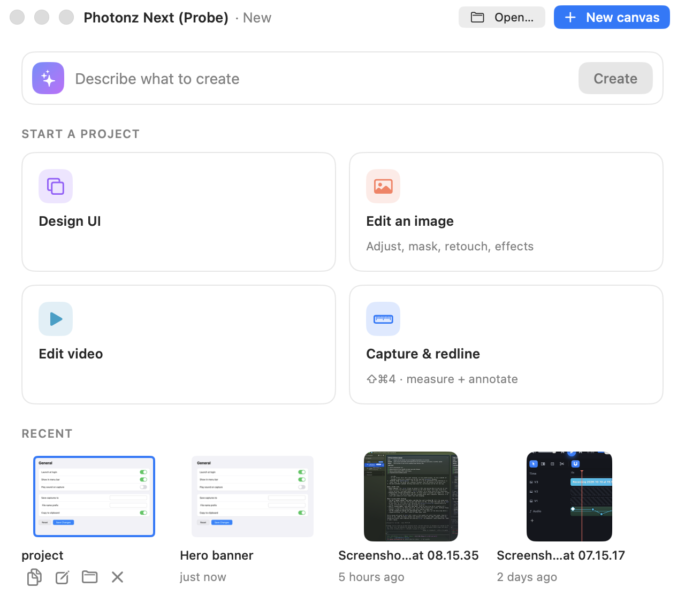

# What a saved document's card under Recent offers

## The surface

In Photonz Next, **File > New Window** opens the *front door*: a prompt bar,
four templates under *Start a project*, and a row of cards under **Recent**.
Recent mixes your newest captures with documents you opened or saved
(projects, pictures, recordings), newest first, four cards at most.

The mock is the front door walkthrough:
http://127.0.0.1:8791/index.html#ui-entry-wt (Recent strip). There, pointing at
any card swaps its "2 hours ago" line for four small buttons:
**Copy, Edit, Pin, Delete**.

## What ships today

- **Capture cards** (from screenshot history) show Copy, Edit, Show in Finder
  and Delete. Delete moves the capture to the Bin, as history's Delete does.
- **Document cards** (something you saved yourself) show **Copy, Edit, Show in
  Finder** and an **X** that means *Remove from Recent*: the card leaves the
  list and the file stays where you saved it.
  - Copy is new today: it puts the document's full-size picture on the
    clipboard, ready to paste into Slack, Mail or a doc.
- **Pin** exists nowhere in the app yet.

The same verbs are on the card's right-click menu.

## The two questions

1. **Should the last button on a document card delete the file?** On a capture
   it does, because history owns its captures. A document may live on your
   Desktop or in a shared folder; a launcher throwing it away can surprise
   you. Finder's and Premiere's recent lists only ever *remove from the list*.
2. **Is Pin wanted?** Pin would keep a card at the front of Recent however
   much you open afterwards. It applies to captures and documents alike, so
   building it means a pinned look on a card and a pinned group at the front
   of the row.

## The options

- **a. Keep Remove from Recent, no Pin.** What ships now. Safest, nothing to
  build, differs from the mock (no Pin; X instead of a trash can).
- **b. Copy, Edit, Pin, Remove from Recent** (recommended). The mock's four
  buttons in its order, with the last one only taking the card off the list.
  Show in Finder moves to the right-click menu. Pin gets built for every card.
- **c. The mock exactly.** Delete on a document moves the file to the Bin
  after a confirm. Pin as in b.
