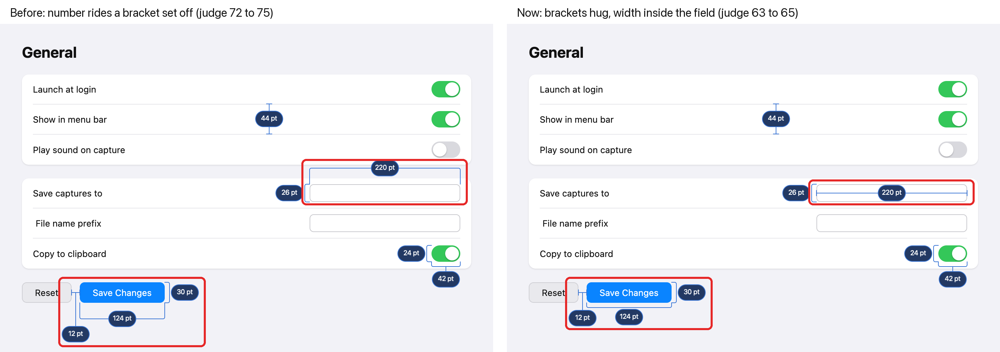

# Close the redline task on its pictures, or keep chasing a score?

## What this is about

When you ask Photonz to annotate a screenshot with measurements, it draws a
**redline**: brackets and lines around the parts of the screen, each with a
small dark pill holding the number ("124 pt"). On 2026-10-20 you asked for a
calm redline: numbers in points on a Retina screenshot, every line starting and
stopping on the edges it measures, and a score of 8 out of 10 from the agent
judge on "clean" and "aligned".

## What is done

- Every number on a 2x screenshot now says **pt** (124 pt for a 248 pixel button).
- Dimension lines carry end ticks, so you can see where a span stops.
- Brackets hug their object. An empty text field carries its width across its
  own middle. No mark's line runs into another mark, and no number hangs on a
  line longer than its own pill.

The pictures: left is the layout before the last pass, right is today.
Red boxes mark the two places that changed most (the field's 220 pt width, and
the 124 pt / 12 pt marks under Save Changes).

## Why it is stuck

The judge's score on this screen is about 5 to 6 on clean. Hand-drawn
redlines of the same screen, placed by a person-like ideal, scored 5.0 to 6.3
from the same judge. So 8 may not be reachable on this picture by moving marks
at all. The judge also prefers the left layout by about 10 points, while the
right one is the one that meets your own read of the picture (no leg into
another mark, no long line to a number, brackets on their objects).

## Your options

- **Close it on the pictures (recommended).** Keep the right layout and end the task.
- **Go back to the left layout.** Higher judge score, but brings back the leg
  into the 26 pt mark and the long line to 12 pt.
- **Keep going for 8.** More passes; the evidence says 8 may not exist here.

More pictures: `queue/audits/2026-11-11-redline-hugs.json` (sign-in screen and
people list, before and after).
