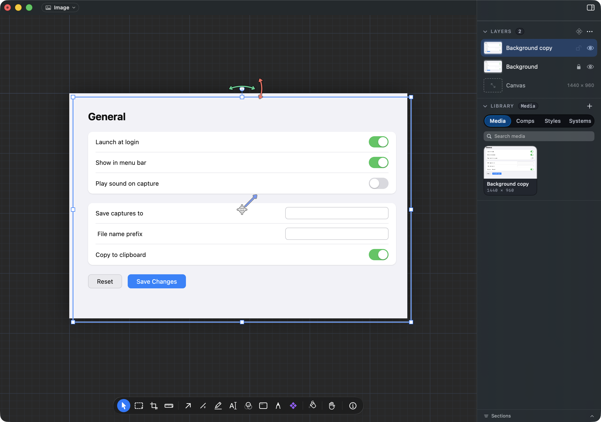
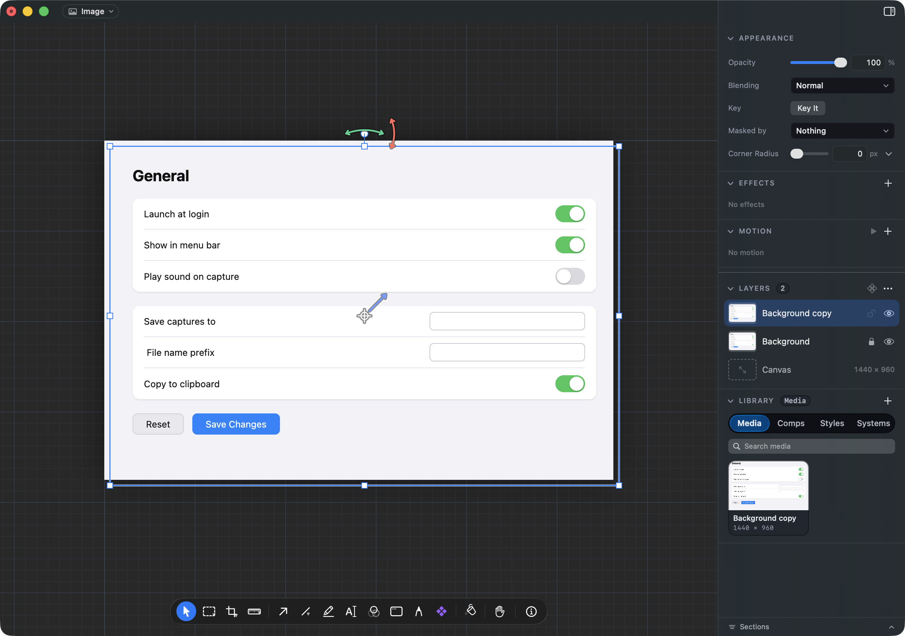

# When should the Layers list make way for a layer you just picked from it?

## What this is about

The right hand panel has two parts. The top part shows the settings of whatever you picked (Appearance, Effects, Motion, and so on). Under it, a pane holds the document's lists: Layers and the Library.

Since 2026-10-18 the top part only takes the room its open sections need, and the pane of lists fills everything else. You asked for that after finding a large empty gap above the Library with every section folded.

One consequence: on a picture with **nothing picked**, the top part is empty, so the Layers pane fills the whole panel. When you then **click a layer in that list**, its settings need room above, so the pane has to get shorter. This card is about when that happens.

## What it looks like today (option a, already built)

- **Pointer still on the row you clicked:** the list holds still. The row stays under the pointer and is lit as picked. The settings are not on screen yet.
  
- **Pointer moves out of the list** (toward the settings, or onto the canvas): the pane shrinks on the same short curve a section uses to fold, and the settings appear above it.
  

This is the browser tab-bar pattern: closing a tab never moves the next tab's close button under your pointer, and the tabs resize once the pointer leaves the bar. It also keeps the rule from 2026-10-14 that a click in the pane never moves what is under the pointer (a second click on the same spot used to miss).

## The options

**a. Wait until the pointer leaves the list** (built, recommended). Nothing moves under the pointer. The settings show up as you move toward them.

**b. Make way at once.** The settings appear in the same frame as the click, and the list slides down, often by a few hundred points, so the row you clicked leaves the pointer. A quick second click would land on another row.

**c. Wait a beat, then make way.** The list holds still for about half a second, then slides down even if the pointer has not moved.

This only matters for a pick made from the list when the settings are taller than what was showing before. Clicking on the canvas, or between two layers whose settings already overflow the panel, moves nothing either way.
