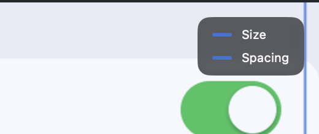

# What the measuring key should do now that Size and Gap share one blue

## What the key is

When the Measure tool is on (press **I**), a small glass card sits in a corner
of the picture listing the kinds of measurement you have drawn: **Size**,
**Spacing**, and **Alignment** if you have an alignment check. Each row has a
short line beside it meant to match how that kind is drawn on the picture.

The redline mock draws this key with Size in red, Spacing in blue and Alignment
dashed: [redline mock](http://127.0.0.1:8791/index.html#redline).

## What changed

On 2026-10-13 you said Size and Gap should not be different colours, so every
measurement now starts in the same blue. The key still lists both kinds, each
with an identical blue line:

The whole window at the time: [full picture](../audits/2026-10-15-measure-legend-same-swatch-sc.png).
A Size (124 px under the Save button, 149 px at the top) and a Gap (20 px
between the two groups) are both on the picture, and they are drawn the same
way, so the key cannot tell them apart.

Only Alignment still reads differently, because it is drawn dashed.

## The options

**A. Take the key away (recommended).** Nothing sits in the corner while you
measure. Every measurement keeps its value chip, and the bar under the canvas
still says whether you are drawing a Size or a Gap. Photoshop and Figma show no
key for their measurements. The cost is that a dashed Alignment check has no
line naming it; its chip already names the edge it checked.

**B. Draw Size and Gap differently, and the key shows how.** Still one blue,
but a Size gets short bars across each end and a Gap gets a bracket. The key
shows each row in its own shape. This changes how every measurement looks on the
picture, which you just settled as one look, so it only fits if you want the two
kinds told apart on the picture itself.

**C. Keep the key as it is.** No change: two rows with the same blue line. Picking
this retires the task.
